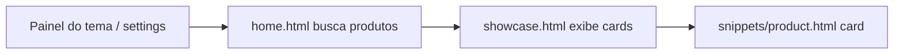

## Visão geral (3 camadas)



| Camada | Arquivo | Função |
|--------|---------|--------|
| **Config** | `configs/settings.html` + `settings.json` | Título, ID da categoria, quantidade |
| **Dados** | `pages/home.html` | Chama `Products()` com filtro `categories` |
| **Visual** | `elements/showcase.html` + `snippets/product.html` | Grid/carrossel dos cards |

---

## O que já existe no tema

### 1. Vitrines por selo (destaque / novidades)

Em `home.html`, **sem** categoria — só filtro de selo:

```7:24:c:\Users\Usuário\Documents\www\ecommerce\pages\home.html
        
            
                
            ...
            <div class="section-showcase">
                
```

### 2. Vitrine por categoria (o modelo que você quer)

Em `categories-showcase.html` — aqui está o filtro por categoria:

```28:37:c:\Users\Usuário\Documents\www\ecommerce\elements\snippets\categories-showcase.html
                 
    
                
```

O ID da categoria vem do painel:

```140:142:c:\Users\Usuário\Documents\www\ecommerce\configs\settings.json
        "text_category_1": "SEU NOVO SOLAR ESTÁ AQUI!",
        "id_category_1": "75",
        "qnt_catego": "16",
```

A home só inclui o bloco:

```33:33:c:\Users\Usuário\Documents\www\ecommerce\pages\home.html
    
```

---

## Passo a passo para implementar uma nova listagem por categoria

### Passo 1 — Criar a categoria no painel Tray

1. Admin Tray → **Produtos → Categorias**
2. Crie a categoria (ex.: “Dia dos Namorados”)
3. Associe os produtos a ela
4. Anote o **ID numérico** da categoria (aparece na URL ou na listagem de categorias)

> Sem produtos na categoria, a vitrine fica vazia ou mostra “Nenhum produto encontrado”.

---

### Passo 2 — Escolher o padrão visual

**Opção A — Reaproveitar o bloco atual** (`categories-showcase`)

- Edite no **painel do tema** (Layout → Categoria destacada):
  - `text_category_1` → título da vitrine
  - `id_category_1` → ID da nova categoria
  - `qnt_catego` → 4, 8, 12 ou 16 produtos

Não precisa alterar código se esse layout já serve.

**Opção B — Nova vitrine na home** (recomendado para “Dia dos Namorados” separado)

Em `home.html`, copie o padrão das vitrines de destaque/novidades, mas com `categories`:

```twig

    
    <div class="section-showcase">
        
    </div>

```

Coloque onde quiser na home (ex.: depois dos banners, antes de novidades).

---

### Passo 3 — Adicionar campos no painel do tema (se usar Opção B)

Em `configs/settings.html`, na seção de vitrines da home, crie campos como os de `text_destaque` / `qnt_destaque`:

- `text_dia_namorados` — título (“Dia dos Namorados”)
- `id_dia_namorados` — select de categoria (igual ao `id_category_1` com classe `load-store-categories`)
- `qnt_dia_namorados` — radios 4 / 8 / 12 / 16

Em `configs/settings.json`, valores iniciais:

```json
"text_dia_namorados": "Dia dos Namorados",
"id_dia_namorados": "",
"qnt_dia_namorados": "8"
```

Depois de publicar o tema, preencha o ID da categoria no painel.

---

### Passo 4 — Entender o `Products()`

Parâmetros usados no tema:

| Parâmetro | Exemplo | Efeito |
|-----------|---------|--------|
| `filter` | `['available']` | Só produtos disponíveis |
| `categories` | `[75]` | Só da categoria com ID 75 |
| `limit` | `8` | Máximo de produtos |
| `order` | `'rand'` | Ordem aleatória |

Documentação Tray: [Products()](https://partners.tray.com.br/themes/construindo-seu-template/referencias/funcoes/products)

---

### Passo 5 — Exibição (`showcase` + `product`)

`showcase.html` recebe o array `products` e, para cada item, renderiza o card:

```14:19:c:\Users\Usuário\Documents\www\ecommerce\elements\showcase.html
            
                <div class="item {{ slide ? 'swiper-slide' }}">
                    
```

- `slide: true` → carrossel Swiper (`settings.carrosel_index`)
- `slide: false` → grade (`flex f-wrap`)

---

### Passo 6 — Publicar e testar

1. Salve os arquivos do tema
2. Publique/atualize o tema na Tray
3. No painel do tema, configure título + ID da categoria + quantidade
4. Abra a home e confira se os produtos aparecem

---

## Coleção vs categoria

No tema atual, o filtro documentado é **`categories` (ID de categoria)**.  
Se no painel Tray você criar uma **coleção** (recurso separado de categoria), pode não existir filtro `collections` no `Products()` — nesse caso o caminho mais seguro é:

- criar uma **categoria** “Dia dos Namorados” e colocar os produtos nela, **ou**
- confirmar na documentação da sua versão da Tray se existe parâmetro específico para coleções.

---

## Resumo rápido

1. Categoria no admin + produtos vinculados + anotar o **ID**
2. `Products({ 'categories': [ID], 'filter': ['available'], 'limit': N })` em `home.html`
3. ``
4. (Opcional) Campos em `settings.html` / `settings.json` para editar sem mexer no código
5. Publicar tema e configurar no painel

Se quiser, no próximo passo posso implementar a vitrine “Dia dos Namorados” na `home.html` com os campos no painel do tema (Opção B).

---

**User**

vc consegue criar um documento com a explicação e o passo a passo? um .md talvez?

---

**Cursor**

Criando um documento Markdown com a explicação e o passo a passo no projeto.


Criei o documento em:

**[docs/vitrine-categoria-home.md](c:\Users\Usuário\Documents\www\ecommerce\docs\vitrine-categoria-home.md)**

O arquivo inclui:

- Visão geral das 3 camadas (config → dados → visual)
- O que já existe no tema (destaque, novidades, categoria destacada)
- Referência da função `Products()`
- Passo a passo completo (categoria no admin → Opção A sem código → Opção B com código)
- Exemplos Twig prontos para copiar
- Diagrama Mermaid do fluxo
- Nota sobre categoria vs coleção
- Tabela de arquivos e checklist final

Se quiser, no próximo passo posso implementar a Opção B (“Dia dos Namorados”) direto no código, usando esse guia.

---

**User**

eu nao entendi <label class="input-area max">
    <span class="name">Categoria — Dia dos Namorados</span>
    <select class="select-input load-store-categories change-selected-category">
        <option value="">Selecione</option>
    </select>
    <input type="hidden" name="id_dia_namorados">
</label>

---

**Cursor**

Vou conferir no tema como o select de categoria funciona no painel — isso explica o trecho do documento.


Esse bloco é o **campo do painel do tema** para escolher a categoria — não é o que aparece na loja para o cliente. Funciona em duas partes que trabalham juntas.

## O que cada parte faz

```html
<label class="input-area max">
    <span class="name">Categoria — Dia dos Namorados</span>   <!-- 1. Rótulo visual -->

    <select class="select-input load-store-categories change-selected-category">
        <option value="">Selecione</option>                  <!-- 2. Lista (preenchida depois) -->
    </select>

    <input type="hidden" name="id_dia_namorados">           <!-- 3. Valor que é SALVO -->
</label>
```

| Parte | Função |
|--------|--------|
| `<span class="name">` | Só o texto que o lojista vê no painel |
| `<select>` | Dropdown para **escolher** a categoria |
| `<input type="hidden" name="id_dia_namorados">` | Guarda o **ID** que vai para o `settings.json` |

O `<select>` **não tem** `name="..."`. Por isso o Tray **não salva** o que está no select diretamente — salva o que está no `hidden`.

---

## Por que o `<select>` vem quase vazio?

```html
<select ...>
    <option value="">Selecione</option>
</select>
```

No arquivo HTML do tema só existe essa opção padrão. As categorias reais (Óculos, Lentes, Dia dos Namorados, etc.) são **inseridas depois** pelo JavaScript do editor de temas da Tray, por causa da classe:

- `load-store-categories` → busca as categorias da loja e monta as `<option>`
- `change-selected-category` → quando você escolhe uma, copia o ID para o `input hidden`

Ou seja: você não precisa (nem consegue) listar manualmente todas as categorias no HTML.

---

## Fluxo quando o lojista configura

```
1. Abre o painel do tema
2. O JS preenche o <select> com as categorias da loja
3. Lojista escolhe "Dia dos Namorados"
4. JS grava o ID (ex: 82) em:  <input name="id_dia_namorados" value="82">
5. Ao salvar, settings.json fica:  "id_dia_namorados": "82"
6. Na home, o Twig usa:  settings.id_dia_namorados  →  Products({ 'categories': [82] })
```

---

## Comparação com o que já existe no tema

É o **mesmo padrão** da “Categoria destacada”:

```4676:4682:c:\Users\Usuário\Documents\www\ecommerce\configs\settings.html
                    <label class="input-area max">
                      <span class="name">Categoria</span>
                      <select class="select-input load-store-categories change-selected-category">
                        <option value="">Selecione</option>
                      </select>
                      <input type="hidden" name="id_category_1">
                    </label>
```

A única diferença no exemplo do doc é o **nome** do campo salvo:

| Bloco atual | Novo (exemplo doc) |
|-------------|---------------------|
| `name="id_category_1"` | `name="id_dia_namorados"` |
| Usado em `categories-showcase.html` | Usado na vitrine que você criar em `home.html` |

O `name` do hidden tem que ser **igual** ao que você usa no Twig: `settings.id_dia_namorados`.

---

## Resumo em uma frase

O `<select>` é só a interface para escolher; o `<input type="hidden">` é o que realmente grava o **ID da categoria** nas configurações do tema.

Se quiser evitar esse campo novo, use a **Opção A** do doc: só altere `id_category_1` no painel na seção que já existe — sem adicionar esse HTML.

