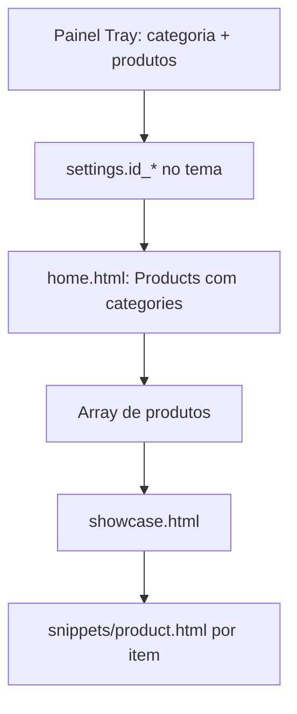

# Vitrine de produtos por categoria na Home

Guia para entender como o tema exibe listagens de produtos na página inicial e como implementar uma nova vitrine filtrada por categoria (ex.: **Dia dos Namorados**).

---

## Visão geral

A listagem na home segue três camadas:

```
Painel do tema (settings)  →  home.html (busca produtos)  →  showcase.html (layout)  →  product.html (card)
```

| Camada | Arquivos | Responsabilidade |
|--------|----------|------------------|
| Configuração | `configs/settings.html`, `configs/settings.json` | Título, ID da categoria, quantidade de produtos |
| Dados | `pages/home.html`, snippets | Chama `Products()` com filtros |
| Visual | `elements/showcase.html`, `elements/snippets/product.html` | Grid ou carrossel dos produtos |

---

## O que já existe no tema

### 1. Vitrines por selo (destaque / novidades)

Arquivo: `pages/home.html`

Produtos filtrados por selo (`featured`, `new`), **sem** categoria:

```twig



```

Configurações no painel: `text_destaque`, `qnt_destaque`.

---

### 2. Vitrine por categoria (categoria destacada)

Arquivo: `elements/snippets/categories-showcase.html`

Incluída na home com:

```twig

```

Busca produtos **da categoria** informada no painel:

```twig

```

Configurações no painel (`configs/settings.json`):

| Campo | Exemplo | Uso |
|-------|---------|-----|
| `text_category` | `#OTICASFOTOPAULO` | Título do bloco lateral |
| `subtext_category` | `Enxergar bem...` | Subtítulo |
| `text_category_1` | `SEU NOVO SOLAR...` | Título da listagem |
| `id_category_1` | `75` | **ID da categoria** na Tray |
| `qnt_catego` | `16` | Quantidade de produtos (4, 8, 12 ou 16) |

Layout diferente: usa `snippets/product-low` e carrossel Swiper, não o elemento `showcase` padrão.

---

### 3. Componente de exibição (`showcase`)

Arquivo: `elements/showcase.html`

Recebe:

- `products` — array retornado por `Products()`
- `showcaseTitle` — título da seção
- `slide` — `true` = carrossel; `false` = grade

Para cada produto, renderiza o card em `elements/snippets/product.html`.

---

## Função `Products()` (Tray)

Documentação: [Products() — Tray Partners](https://partners.tray.com.br/themes/construindo-seu-template/referencias/funcoes/products)

Parâmetros usados neste tema:

| Parâmetro | Exemplo | Descrição |
|-----------|---------|-----------|
| `filter` | `['available']` | `featured`, `new`, `free_shipping`, `available`, `promotion` |
| `categories` | `[75]` | IDs das categorias (filtro principal para vitrine por categoria) |
| `limit` | `8` | Quantidade máxima de produtos |
| `order` | `'rand'` | Ordenação (`id`, `name`, `price`, `rand`, etc.) |
| `brands` | `'Marca X'` | Filtro por marca (opcional) |

Exemplo mínimo para uma categoria:

```twig

```

---

## Passo a passo: nova vitrine na Home

### Passo 1 — Categoria no painel Tray

1. Acesse o admin: **Produtos → Categorias**
2. Crie a categoria (ex.: **Dia dos Namorados**)
3. Vincule os produtos desejados a essa categoria
4. Anote o **ID numérico** da categoria (URL da edição ou listagem)

> Sem produtos na categoria, a vitrine fica vazia ou exibe a mensagem de “Nenhum produto encontrado”.

---

### Passo 2 — Escolher abordagem

#### Opção A — Usar o bloco já existente (sem código)

Edite no **painel do tema** → seção **Categoria destacada**:

- `text_category_1` → título da vitrine
- `id_category_1` → ID da nova categoria
- `qnt_catego` → quantidade de produtos

O bloco `categories-showcase` já está na home. Só troca a configuração.

**Limitação:** um único slot de categoria (`id_category_1`) com layout fixo (lateral + carrossel `product-low`).

---

#### Opção B — Nova vitrine dedicada (com código)

Recomendado para campanhas como “Dia dos Namorados”, com o mesmo visual das vitrines de destaque/novidades.

**2.1** Em `pages/home.html`, adicione (ajuste a posição conforme o layout):

```twig

    
    <div class="section-showcase">
        
    </div>

```

**2.2** Em `configs/settings.html`, na aba de vitrines da home, adicione campos no mesmo padrão de `text_destaque`:

- Campo de texto → `text_dia_namorados` (título)
- Select de categoria com classe `load-store-categories` → `id_dia_namorados`
- Radios 4 / 8 / 12 / 16 → `qnt_dia_namorados`

Exemplo de select (espelhando `id_category_1`):

```html
<label class="input-area max">
    <span class="name">Categoria — Dia dos Namorados</span>
    <select class="select-input load-store-categories change-selected-category">
        <option value="">Selecione</option>
    </select>
    <input type="hidden" name="id_dia_namorados">
</label>
```

**2.3** Em `configs/settings.json`, valores padrão:

```json
"text_dia_namorados": "Dia dos Namorados",
"id_dia_namorados": "",
"qnt_dia_namorados": "8"
```

**2.4** Publique o tema e configure no painel o ID da categoria e o título.

---

### Passo 3 — Publicar e testar

1. Salve os arquivos do tema
2. Publique/atualize o tema na Tray
3. No painel do tema, preencha título, categoria e quantidade
4. Abra a home e valide:
   - produtos corretos
   - quantidade respeitada
   - carrossel ou grade conforme `carrosel_index`

---

## Fluxo de dados (diagrama)



---

## Categoria vs coleção

Neste tema, o filtro documentado em `Products()` é **`categories`** (ID de categoria).

- **Categoria** — recurso nativo; use `categories: [ID]` (como em `categories-showcase.html`).
- **Coleção** — recurso do painel Tray que pode ser distinto de categoria. Confirme na documentação da sua versão se existe parâmetro `collections` em `Products()`. Se não existir, o caminho mais seguro é criar uma **categoria** para a campanha e vincular os produtos a ela.

---

## Arquivos de referência

| Arquivo | Papel |
|---------|-------|
| `pages/home.html` | Página inicial; inclui vitrines e snippets |
| `elements/showcase.html` | Layout da vitrine (título + lista) |
| `elements/snippets/product.html` | Card de um produto |
| `elements/snippets/categories-showcase.html` | Vitrine por categoria (layout alternativo) |
| `elements/snippets/product_category.html` | Exemplo de `Products()` + categoria em outro contexto |
| `configs/settings.html` | Formulário do painel do tema |
| `configs/settings.json` | Valores salvos das configurações |

---

## Checklist de implementação

- [ ] Categoria criada no admin Tray
- [ ] Produtos associados à categoria
- [ ] ID da categoria anotado
- [ ] Código em `home.html` (Opção B) ou config no painel (Opção A)
- [ ] Campos em `settings.html` / `settings.json` (se Opção B)
- [ ] Tema publicado
- [ ] Painel do tema configurado
- [ ] Home testada em desktop e mobile

---

## Suporte

- [Products() — Tray](https://partners.tray.com.br/themes/construindo-seu-template/referencias/funcoes/products)
- [Objeto products — Tray](https://partners.tray.com.br/themes/construindo-seu-template/referencias/objetos/products)
